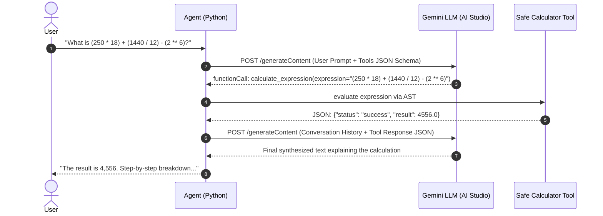

# Zero-Framework Agentic AI with Gemini & Calculator Tool

Designed from the ground up by a senior agentic systems architect: a pure Python, zero-orchestrator-framework AI agent powered by **Google AI Studio Gemini LLM** and equipped with an arithmetic **Calculator Tool** defined and driven by native **JSON schemas**.

---

## 🏛️ Why Zero-Framework (No LangChain / LlamaIndex)?

In enterprise production environments, heavy orchestrators often introduce:
1. **Hidden Abstraction Bloat**: Dozens of nested classes making latency tracing and token management difficult.
2. **Brittle Dependency Trees**: Frequent breaking changes across version bumps.
3. **Black-box Tool Calling**: Obscured JSON payload manipulation.

This implementation uses **direct JSON Function Calling protocol** with Gemini. You have 100% control over the prompt, payload, tool routing, conversation history, and security boundary.

---

## 📁 Project Structure

```text
gemini_agent_calculator/
├── calculator_tools.json   # Exact JSON schema specification for the tools
├── calculator.py           # Secure AST-based arithmetic execution engine
├── tools.py                # Schema declarations & tool execution dispatcher
├── agent.py                # Pure Python Agent loop (direct REST / JSON API)
├── agent_sdk.py            # Alternative using official google-genai SDK
├── main.py                 # Interactive CLI & automated demo queries
└── README.md               # Architecture documentation
```

---

## 🛠️ The Calculator Tool JSON Schema

The tool is declared in standard OpenAPI/Gemini JSON Schema format in [`calculator_tools.json`](calculator_tools.json):

```json
{
  "tools": [
    {
      "function_declarations": [
        {
          "name": "calculate_expression",
          "description": "Evaluates a complete mathematical arithmetic expression with proper operator precedence and parentheses. Supports +, -, *, /, // (floor div), % (modulo), ** (power).",
          "parameters": {
            "type": "object",
            "properties": {
              "expression": {
                "type": "string",
                "description": "The arithmetic expression to evaluate (e.g., '145 * 12 + (300 / 5)', '2 ** 10', '95 % 4')."
              }
            },
            "required": ["expression"]
          }
        },
        {
          "name": "basic_arithmetic",
          "description": "Performs a single discrete arithmetic operation between two numbers.",
          "parameters": {
            "type": "object",
            "properties": {
              "operation": {
                "type": "string",
                "enum": ["add", "subtract", "multiply", "divide", "modulo", "power"],
                "description": "The arithmetic operation to perform."
              },
              "a": { "type": "number", "description": "The first number." },
              "b": { "type": "number", "description": "The second number." }
            },
            "required": ["operation", "a", "b"]
          }
        }
      ]
    }
  ]
}
```

---

## 🔄 The Agentic Execution Cycle



---

## 🛡️ Security Best Practices
- **No `eval()`**: Many beginner tutorials use Python's `eval()`, which is a critical security vulnerability (allowing arbitrary code execution via prompt injection). This engine uses Python's `ast` (Abstract Syntax Tree) to strictly validate and compute only mathematical nodes.
- **Resource Protection**: Caps exponent size to prevent denial-of-service / memory overflow.
- **Zero Division Safety**: Catches division by zero and returns a descriptive error message to the LLM so it can explain the mathematical error gracefully.

---

## 🚀 Quick Start

### 1. Set your Google AI Studio API Key
```powershell
$env:GEMINI_API_KEY="YOUR_GEMINI_API_KEY"
```

### 2. Run the Agent
```powershell
python main.py
```
You can choose:
1. **Automated Demo Queries**: Runs pre-configured multi-step arithmetic problems, percentages, and edge cases.
2. **Interactive Chat Session**: Talk directly with your agent.
